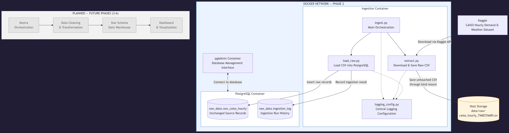

# California Electricity Demand and Weather Analytics

This project downloads the CAISO hourly demand and population-weighted weather dataset from Kaggle, preserves the original CSV in `data/raw/`, and loads its source fields into a PostgreSQL raw layer with batch-level ingestion records. Phases 1–3 are complete; the data-quality deliverables listed as Phase 4 in the roadmap were implemented with Phase 3 to match the supplied Phase 3 brief. Phases 5–6 have not started.

**Project status:** Phase 1 — Done; Phase 2 — Done (verified by running the ingestion and SQL proof/profile scripts); Phase 3 — Done (cleaning, star schema, all six SQL views, 19 pre-load checks, 34 post-load checks, and both failure demos verified on the existing 98,968-row batch; no fresh Kaggle download was performed during this verification); Phase 4 data quality — Done alongside Phase 3; Phases 5–6 — Not started.

## Table of contents

- [Team](#team)
- [Dataset](#dataset)
- [Analytical questions](#analytical-questions)
- [Architecture](#architecture)
- [Project guide](#project-guide)
- [Prerequisites and Quick Start](#prerequisites-and-quick-start)
- [Command reference](#command-reference)
- [What is in this repository](#what-is-in-this-repository)
- [How ingestion works](#how-ingestion-works)
- [How cleaning differs from ingestion](#how-cleaning-differs-from-ingestion)
- [How dependencies work (no virtualenv)](#how-dependencies-work-no-virtualenv)
- [How to look at the data](#how-to-look-at-the-data)
- [Running it more than once](#running-it-more-than-once)
- [Data profiling](#data-profiling)
- [Troubleshooting](#troubleshooting)
- [Roadmap](#roadmap)
- [Security](#security)

## Team

| Name | ID | Phase 1 Role | Phase 2 Role | Phase 3 Role |
|------|----|--------------|---------------|---------------|
| Hisham Wael Hosny | 692300279 | Dataset description & data dictionary | Raw data profiling and notes | Pre-load checks, Phase 3 notes, and Q2 views |
| Zeyad Mohamed | 692300066 | Docker setup (PostgreSQL, pgAdmin), GitHub repo & submission video | Docker, Compose, integration | Docker integration, pipeline runner, Q1 views, README, and lab checklist |
| Mohamed Mostafa | 692300110 | Architecture diagram | Logging, ingest entry point, architecture diagram | Post-load SQL checks, fail-fast runner, failure demos, and `DATA_QUALITY.md` |
| Basel Tamer Fathy | 692300055 | Database table design (star schema) | Raw schema and loader | Star-schema DDL, warehouse load SQL, and ER diagram |
| Fatma Shrief | 692300201 | Dataset selection, proposal lead, analytical questions (Q1-Q3) | Kaggle extraction (`scripts/extract.py`) | Python cleaning module and Q3 views |

## Dataset

| | |
|---|---|
| Name | CAISO Hourly Demand + Population-Weighted Weather |
| Source | https://www.kaggle.com/datasets/arimancy/caiso-hourly-demand-weather |
| Publisher / License | Arimancy LLC / CC BY 4.0 |
| Size | ~98,968 rows x 35 columns (hourly records) |
| Period | July 2015 to October 2026 |
| Format | Parquet and CSV |
| Demand source | EIA-930 hourly grid data (cleaned by Catalyst Cooperative / PUDL) plus a short recent tail from the EIA API. CAISO covers roughly 80% of California load. |
| Weather source | ERA5 reanalysis (via Open-Meteo) at 7 cities (Los Angeles, Riverside, San Diego, San Francisco, San Jose, Sacramento, Fresno), combined using Census population weights. |

The full data dictionary is in `docs/`.

## Analytical Questions

1. **Temperature effect:** How does temperature affect hourly electricity demand? At what temperature does demand start to go up fast?
2. **Solar and the daily load shape:** How has the midday dip in demand changed from 2015 to 2026 in each season? How do sunshine and cloud cover relate to it?
3. **Calendar and cities:** How do the hour of the day, weekends, and holidays affect peak demand? Which of the 7 cities' temperatures explains demand best?

## Architecture

The image below shows the current Phase 2 implementation. Its future-phases panel is explicitly marked as planned in the diagram.

- **Docker:** software for packaging and running applications in isolated environments.
- **Docker Engine:** the runtime service that builds images and runs containers.
- **Docker Desktop:** a desktop application that bundles Docker Engine and its management interface.
- **Image:** a packaged template from which Docker creates a container.
- **Dockerfile:** instructions Docker follows to build an image.
- **Container:** an isolated running instance of an image.
- **Docker Compose:** the command-line tool that configures and runs the project's services from `docker-compose.yml`.
- **Build context:** the files Docker receives for an image build; `.dockerignore` excludes files from it.
- **Build layer:** a cached filesystem result of a Dockerfile step that can be reused when its inputs have not changed.
- **Service:** a named container configuration in the Compose file, such as `postgres`, `pgadmin`, `ingest`, or `clean`.
- **Compose project name:** a label that groups a Compose stack's resources; `-p readme_test` gives the test stack separate named volumes.
- **Network:** a private connection that lets the project's containers reach each other by service name.
- **Bind mount:** a mapping from a host folder to a path inside a container; here `./data/raw` maps to `/data/raw`.
- **Named volume:** Docker-managed persistent storage; `pgdata` holds PostgreSQL database files.
- **Port mapping:** a route from a host port to a container port, making PostgreSQL available on `localhost:5432` and pgAdmin on `localhost:8080`.
- **Healthcheck:** a repeated readiness test; PostgreSQL's check runs `pg_isready`.
- **Compose profile:** an optional service group; the `ingest` and `clean` profiles keep one-off jobs out of the default `up` startup.



## Project guide

For the detailed service-by-service ingestion and cleaning flows, schema
overview, and file-by-file inventory, see the [Project Guide](PROJECT_GUIDE.md).

**Phase 3 cleaning pipeline (verified on the existing successful 98,968-row raw batch; a fresh Kaggle download was not re-tested):**

```text
[Successful raw batch] -> [Python cleaning + pre-load checks] -> [clean_data staging]
    -> [dw full refresh + post-load checks] -> [commit]
```

Implemented Compose services:

| Service | Image or build | Access / start behavior |
|---|---|---|
| `postgres` | `postgres:16` | `localhost:5432`; started by `docker compose up -d`. |
| `pgadmin` | `dpage/pgadmin4` | http://localhost:8080; started by `docker compose up -d`. |
| `ingest` | Built from `scripts/Dockerfile` | On demand with `docker compose run --rm ingest`; enabled by the `ingest` profile. |
| `clean` | Built from `scripts/Dockerfile` | On demand with `docker compose run --rm --build clean`; enabled by the `clean` profile. |

## Prerequisites and Quick Start

You need:

- Docker Desktop (with its WSL 2 backend on Windows) or Docker Engine with Docker Compose v2.
- Git.
- A Kaggle account with API credentials.

Check Docker and Compose:

```bash
docker --version
docker compose version
```

From a terminal, clone the repository and create your local environment file:

```bash
git clone https://github.com/z3yad30/DE_Project.git
cd DE_Project
cp .env.example .env
```

Edit `.env` and set `KAGGLE_USERNAME` and `KAGGLE_KEY`. Find them in your Kaggle account under **Settings -> API**; create an API token if needed. Keep both values private. The dataset slug is configured as `arimancy/caiso-hourly-demand-weather`.

Start the database and pgAdmin, check that PostgreSQL is healthy, and run ingestion:

```bash
docker compose up -d
docker compose ps
docker compose run --rm ingest
docker compose run --rm --build clean
```

On the verified dataset, the first successful ingestion run logged `Records fetched: 98968`, `Records loaded into raw_data.raw_caiso_hourly: 98968`, and a `SUMMARY` with `status=SUCCESS http=200 fetched=98968 loaded=98968`. The CSV is stored in `./data/raw/`; the `raw_data.raw_caiso_hourly` table contains the rows. The clean command selects the latest successful batch, rebuilds staging and `dw`, and reports its quality checks and row counts.

To see the latest database result from the terminal:

```bash
set -a
. ./.env
set +a
docker compose exec -T postgres psql -U "$POSTGRES_USER" -d "$POSTGRES_DB" \
  -c "SELECT status, http_status, rows_fetched, rows_loaded FROM raw_data.ingestion_log ORDER BY started_at DESC LIMIT 5;"
```

The raw files and `.env` are git-ignored; do not commit them.

## Command reference

Run these commands from the repository root. They use the default Compose project name; for the isolated validation run, the same commands were prefixed with `docker compose -p readme_test`.

| Command | What it does | When to use it | What you should see |
|---|---|---|---|
| `docker compose up -d` | Starts the default services in the background. | First setup or after stopping the stack. | `postgres` becomes healthy and `pgadmin` starts; the profiled `ingest` and `clean` services are not started. |
| `docker compose ps` | Shows the Compose containers and their status. | Check readiness and mapped ports. | `postgres` reports healthy; `pgadmin` is running. |
| `docker compose build ingest clean` | Builds the ingestion and cleaning images from `scripts/Dockerfile`. | After changing pipeline code or `scripts/requirements.txt`. | Build completes and reports both images as built. |
| `docker compose run --rm ingest` | Starts a one-off ingestion container, runs `scripts/ingest.py`, then removes that container. | Download and load the Kaggle CSV. | Log lines end with `SUMMARY ... status=SUCCESS` or `status=SKIPPED`; failures return a nonzero exit code. |
| `docker compose run --rm --build clean` | Builds and runs the one-off cleaning pipeline container. | First clean run or after code changes. | Cleaning counts, pre-load and post-load `DQ PASS` lines, and `PIPELINE SUMMARY status=SUCCESS`; a failed stage rolls back and returns `1`. |
| `docker compose run --rm clean` | Runs `scripts/run_pipeline.py` in a one-off container. | Clean the latest successful raw batch after the image is built. | Same pipeline stages and summary as the build-and-run command. |
| `docker compose run --rm clean python scripts/demo_preload_fail.py --case negative_demand` | Injects a negative demand value into an in-memory clean-data copy and runs pre-load checks. | Demonstrate a pre-load rejection without writing the injected value. | `demand_mwh_positive` fails; the command returns `1`. |
| `docker compose run --rm clean python scripts/demo_quality_fail.py --case negative_demand` | Copies the warehouse into `dw_test`, corrupts the copy, and runs post-load checks. | Demonstrate a post-load failure without modifying `dw`. | `demand_mwh_positive` fails, `dw_test` is dropped, and the command returns `1`. |
| `docker compose run --rm clean python scripts/run_quality.py` | Runs the standalone SQL post-load checks against `dw`. | Recheck the warehouse without running cleaning. | One result line per check and a `DQ SUMMARY`; failures return `1`. |
| `docker compose exec -T postgres psql -U "$POSTGRES_USER" -d "$POSTGRES_DB" < sql/06_views_q1.sql` | Creates the two Q1 temperature-demand views. | Run the temperature-bin and demand-slope analysis after a warehouse load. | `CREATE VIEW` for each Q1 view; query `dw.v_q1_demand_by_temp_bin` and `dw.v_q1_demand_slope` to inspect results. |
| `docker compose exec -T postgres psql -U "$POSTGRES_USER" -d "$POSTGRES_DB" < sql/07_views_q2.sql` | Creates the Q2 solar and load-shape views. | Run the solar and daily-load-shape analysis. | `CREATE VIEW` for each Q2 view. |
| `docker compose exec -T postgres psql -U "$POSTGRES_USER" -d "$POSTGRES_DB" < sql/08_views_q3.sql` | Creates the Q3 calendar and city-temperature views. | Run the calendar-peak and city-correlation analysis. | `CREATE VIEW` for each Q3 view. |
| `docker compose run --rm ingest python scripts/load_raw.py /data/raw/<file>.csv` | Manually loads the named CSV using the loader, bypassing the SHA-256 skip check. Replace `<file>` with a real filename; `/data/raw` is the container path mapped to the host folder `./data/raw`. | Manually append a CSV batch for testing. | The loader prints the number of inserted rows; the table row count increases by that amount. |
| `docker compose logs` | Displays logs for the running default services. | Inspect PostgreSQL or pgAdmin startup. | Service logs appear; a completed `run --rm ingest` prints its logs directly to the terminal and is not retained as a running service. |
| `docker compose logs -f postgres` | Follows PostgreSQL logs. | Watch database startup or connection messages. | PostgreSQL log output continues until interrupted with Ctrl+C. |
| `docker compose down` | Stops and removes the project's containers and network, preserving named volumes and `data/raw/`. | Stop the stack without deleting stored database data. | Containers and network are removed; the next `up -d` reuses the volumes. |
| `docker compose down -v` | Stops the stack and removes its named volumes. | Only when you intentionally want to erase the database and pgAdmin state. | **Warning: deletes the PostgreSQL database volume and pgAdmin volume.** Do not use this command on a project whose database you need to keep. |
| `docker compose exec postgres psql -U "$POSTGRES_USER" -d "$POSTGRES_DB"` | Opens an interactive `psql` session inside the running database container. | Browse or query the database interactively. | A `psql` prompt; enter `\dt raw_data.*` to list the raw tables and `\q` to exit. |
| `docker compose exec -T postgres psql -U "$POSTGRES_USER" -d "$POSTGRES_DB" < sql/02_raw_proof.sql` | Runs the repository's raw-layer proof queries. | Check row counts, batches, ingestion logs, sample rows, and column types. | Query results, including the total row count and latest ingestion outcomes. |
| `docker compose exec -T postgres psql -U "$POSTGRES_USER" -d "$POSTGRES_DB" < sql/03_profile_raw.sql` | Runs the profiling queries against the most recently loaded batch. | Review raw data quality findings. | A sequence of profiling result sets; it does not change the raw rows. |

Before using the `psql` commands that reference `$POSTGRES_USER` and `$POSTGRES_DB`, load the values from `.env` in the current shell:

```bash
set -a
. ./.env
set +a
```

`docker compose exec -T` disables the pseudo-terminal so SQL files can be redirected into `psql`.

## What is in this repository

```text
DE_Project/
├── DATA_QUALITY.md
├── data/
│   └── raw/                         # Runtime CSVs; git-ignored and not committed
├── docs/
│   ├── .gitkeep
│   ├── Project_Proposal_CAISO_Demand_Weather.pdf
│   ├── architecture_phase2.png
│   ├── er_diagram.md
│   ├── er_diagram.png
│   ├── evidence/
│   │   ├── quality_fail_duplicate_pk.txt
│   │   ├── quality_fail_negative_demand.txt
│   │   ├── quality_fail_null_spike.txt
│   │   ├── quality_fail_orphan_fk.txt
│   │   └── quality_pass.txt
│   ├── lab_demo_checklist.md
│   ├── lab_demo_checklist_phase3.md
│   ├── phase2_notes.md
│   ├── phase2_profiling_details.md
│   └── phase3_notes.md
├── flows/
│   └── .gitkeep
├── scripts/
│   ├── .gitkeep
│   ├── Dockerfile
│   ├── clean.py
│   ├── demo_preload_fail.py
│   ├── demo_quality_fail.py
│   ├── dq_common.py
│   ├── extract.py
│   ├── ingest.py
│   ├── load_raw.py
│   ├── logging_config.py
│   ├── preload_checks.py
│   ├── requirements.txt
│   ├── run_pipeline.py
│   └── run_quality.py
├── sql/
│   ├── .gitkeep
│   ├── 01_raw_schema.sql
│   ├── 02_raw_proof.sql
│   ├── 03_profile_raw.sql
│   ├── 04_schema_dw.sql
│   ├── 05_load_dw.sql
│   ├── 06_views_q1.sql
│   ├── 07_views_q2.sql
│   ├── 08_views_q3.sql
│   └── quality_checks.sql
├── .dockerignore
├── .env.example
├── .gitattributes
├── .gitignore
├── docker-compose.yml
└── README.md
```

`data/raw/` is runtime output and is excluded from Git. A clean clone may not contain the folder until the ingestion container creates it.

### Top-level files

- [README.md](README.md) is this setup and operations guide. Its inputs are the source files and your `.env`; its output is documentation, not a program run.
- [.dockerignore](.dockerignore) excludes `.git`, `.env`, `data/`, `docs/`, and `flows/` from the Docker build context. It is read automatically by `docker compose build ingest`.
- [.env.example](.env.example) is the template for PostgreSQL, pgAdmin, Kaggle, retry, and raw-directory settings. Copy it to `.env`, add your Kaggle credentials, and keep `.env` private.
- [.gitattributes](.gitattributes) marks text for LF line endings and PNG/PDF files as binary; Git applies it during checkout and text normalization.
- [.gitignore](.gitignore) excludes `.env`, `data/`, downloaded data files, and local Python/database artifacts from Git.
- [docker-compose.yml](docker-compose.yml) reads `.env` and configures PostgreSQL, pgAdmin, and the profiled ingestion and cleaning services, including ports, healthcheck, volumes, environment, and network; the profiled jobs stay out of default `up -d`.

### Documentation and runtime folders

- `data/raw/` receives the extracted timestamped CSV from `scripts/extract.py`; its host-side input/output location is `./data/raw/`, and it is not committed to Git.
- `docs/.gitkeep`, `scripts/.gitkeep`, `sql/.gitkeep`, and `flows/.gitkeep` are empty directory placeholders; they have no runtime inputs or outputs.
- [docs/Project_Proposal_CAISO_Demand_Weather.pdf](docs/Project_Proposal_CAISO_Demand_Weather.pdf) is a static project proposal to read with a PDF viewer; it is not run by the pipeline.
- [docs/architecture_phase2.png](docs/architecture_phase2.png) is the architecture image embedded above; it is a static diagram, not an executable input.
- [docs/lab_demo_checklist.md](docs/lab_demo_checklist.md) is the numbered live-demo guide. Its commands operate on the running Compose project; it produces terminal output and database rows rather than a separate file.
- [docs/lab_demo_checklist_phase3.md](docs/lab_demo_checklist_phase3.md) covers the clean pipeline, warehouse checks, Q1-Q3 views, and both failure demos; its commands produce terminal output and database results.
- [docs/phase2_notes.md](docs/phase2_notes.md) summarizes the verified Phase 2 ingestion and profiling findings. Read it as documentation; it is not a command.
- [docs/phase2_profiling_details.md](docs/phase2_profiling_details.md) contains the detailed profiling results behind the summary notes. Read it as documentation; the profiling SQL that generates result sets is `sql/03_profile_raw.sql`.
- [docs/phase3_notes.md](docs/phase3_notes.md) explains the warehouse design, cleaning decisions, and Q1-Q3 view joins, including the verified Q1 sample rows.
- [DATA_QUALITY.md](DATA_QUALITY.md) documents the pre-load and post-load rules, thresholds, failure behavior, and transaction policy.

### Ingestion scripts and configuration

- [scripts/Dockerfile](scripts/Dockerfile) selects Python 3.11, installs `scripts/requirements.txt`, copies the scripts and SQL into the image, and sets `scripts/ingest.py` as the default command. Build it with `docker compose build ingest`.
- [scripts/requirements.txt](scripts/requirements.txt) pins the Python packages used by the ingestion and PostgreSQL code. It is installed during the image build; rebuild the image after editing it.
- [scripts/extract.py](scripts/extract.py) reads `KAGGLE_USERNAME`, `KAGGLE_KEY`, `KAGGLE_DATASET`, `MAX_RETRIES`, and the raw directory; downloads the dataset ZIP, extracts its one CSV to a timestamped file, and returns file metadata. `scripts/ingest.py` calls it; it does not load data into PostgreSQL.
- [scripts/ingest.py](scripts/ingest.py) coordinates one run: it creates a batch ID, ensures the schema, calls extraction, counts CSV data rows, applies the SHA-256 skip guard, loads new data, records the run, and returns exit code 0 or 1. Run it with `docker compose run --rm ingest`.
- [scripts/load_raw.py](scripts/load_raw.py) checks a CSV header, loads its source columns as text through PostgreSQL `COPY`, and appends the rows with batch/file metadata. `scripts/ingest.py` calls it for new files; for a deliberate manual load use the command in the reference table.
- [scripts/clean.py](scripts/clean.py) selects the latest `SUCCESS` batch that contains raw rows, cleans it into typed data, logs before/after statistics, and full-refreshes the clean staging table without taking transaction ownership.
- [scripts/run_pipeline.py](scripts/run_pipeline.py) runs cleaning, pre-load checks, staging and warehouse loads, and post-load checks using one connection and transaction; it commits only when every stage passes.
- [scripts/preload_checks.py](scripts/preload_checks.py), [scripts/run_quality.py](scripts/run_quality.py), and [scripts/dq_common.py](scripts/dq_common.py) provide the shared result format and the pre-load and post-load quality checks. The demo scripts exercise failures without modifying the real warehouse.
- [scripts/logging_config.py](scripts/logging_config.py) configures UTC-formatted stdout logging for the scripts; the other Python modules import it, so it has no separate run command.

### SQL files

- [sql/01_raw_schema.sql](sql/01_raw_schema.sql) creates schema `raw_data`, the raw table, its batch index, and the ingestion log table. `scripts/load_raw.py` executes it through `ensure_schema()`; to run it directly, load `.env` into your shell and use `docker compose exec -T postgres psql -U "$POSTGRES_USER" -d "$POSTGRES_DB" < sql/01_raw_schema.sql`.
- [sql/02_raw_proof.sql](sql/02_raw_proof.sql) contains read-only checks for total rows, sample rows, batch counts, recent ingestion attempts, and column types. Run it with the matching command in the command reference.
- [sql/03_profile_raw.sql](sql/03_profile_raw.sql) creates session-local profiling views/functions and returns quality-check result sets for the latest stored batch. Run it with the matching command in the command reference.
- [sql/04_schema_dw.sql](sql/04_schema_dw.sql) and [sql/05_load_dw.sql](sql/05_load_dw.sql) create and full-refresh the warehouse inside the caller's transaction.
- [sql/06_views_q1.sql](sql/06_views_q1.sql), [sql/07_views_q2.sql](sql/07_views_q2.sql), and [sql/08_views_q3.sql](sql/08_views_q3.sql) define the temperature, solar/load-shape, and calendar/city analysis views.
- [sql/quality_checks.sql](sql/quality_checks.sql) contains the post-load warehouse checks called by `scripts/run_quality.py`.

`flows/` currently contains only its placeholder file; no orchestration flow is implemented.

## How ingestion works

`docker compose run --rm ingest` runs these steps:

1. `scripts/ingest.py` generates a 12-character batch ID, records its UTC start time, and logs `START batch=<id>`.
2. It calls `ensure_schema()` from `scripts/load_raw.py`, which connects to PostgreSQL and runs `sql/01_raw_schema.sql`.
3. It calls `scripts/extract.py`. That script checks the Kaggle credentials, downloads the configured dataset as a ZIP to a temporary file, requires exactly one CSV, extracts the CSV unchanged to `data/raw/caiso_hourly_<UTC timestamp>.csv`, calculates the file's SHA-256 and size, then removes the temporary ZIP.
4. `ingest.py` counts CSV data records without counting the header and logs `Records fetched: <count>`. An empty CSV is rejected and logged as `FAILED`.
5. It checks whether that SHA-256 appears in `raw_data.ingestion_log` with status `SUCCESS`. If it does, it logs `SKIP: this exact file was already loaded` and does not load rows. Otherwise, `load_raw.py` checks that the CSV header exactly matches the source columns in the raw table, copies the source values into a temporary PostgreSQL table as text, and appends the rows with `_batch_id` and `_source_file` metadata.
6. It compares rows loaded with rows fetched; a mismatch fails the run.
7. In a `finally` block it attempts to write the run to `raw_data.ingestion_log` and logs `SUMMARY`.

The raw table adds three metadata fields to the 35 source columns:

| Metadata column | Purpose |
|---|---|
| `_batch_id` | Identifies the ingestion run that appended the row. |
| `_source_file` | Stores the timestamped CSV filename. |
| `_ingested_at` | Stores the PostgreSQL insertion timestamp. |

### Ingestion log lines and statuses

- `START batch=...` begins the run and identifies its batch.
- `Records fetched: ...` is the number of data rows in the extracted CSV, excluding the header.
- `SKIP: this exact file was already loaded` means a prior `SUCCESS` log row has the same SHA-256; no rows are loaded on this attempt.
- `Records loaded into raw_data.raw_caiso_hourly: ...` is the number of rows appended by the loader.
- `SUMMARY batch=... status=... http=... fetched=... loaded=... seconds=...` reports the batch ID, final status, Kaggle HTTP status (or `None` when no response status was recorded), row counts, and elapsed seconds.

The statuses are:

- `SUCCESS`: the file was new, loading completed, and fetched/loaded row counts matched.
- `SKIPPED`: the SHA-256 matches a prior successfully loaded file; `loaded=0`.
- `FAILED`: extraction, schema/connection, header validation, loading, row-count validation, or run logging failed. The script returns exit code `1`; success and skip return exit code `0`.

Connection errors, timeouts, and HTTP 5xx responses are retried up to `MAX_RETRIES` during the initial request, with waits of `2 ** attempt` seconds (2, 4, ...). PostgreSQL connection attempts also retry with exponential waits. HTTP 401, 403, 404, and other non-5xx HTTP errors are not retried. The response-body streaming and ZIP/CSV extraction occur after the request retry loop; a stream interruption there is not retried by the current code. In validation, an interrupted download body produced `FAILED` without loading rows; a subsequent successful run was able to skip the already-loaded dataset.

## How cleaning differs from ingestion

Ingestion checks SHA-256 and skips a file whose content already has a successful
load; otherwise it appends the original source values to the raw tables. Cleaning
selects the latest successful raw batch and rebuilds `clean_data` staging and
`dw` with `TRUNCATE` plus `INSERT` on every run. Reprocessing the same batch
therefore yields the same row counts rather than skipping the cleaning work.

## How dependencies work (no virtualenv)

No local Python installation or virtual environment is needed for the pipeline. The image installs the pinned packages in `scripts/requirements.txt` at build time. The Dockerfile copies the requirements file and installs it before copying the application code so ordinary code edits can reuse the dependency image layer.

After changing Python code or dependencies, rebuild the image:

```bash
docker compose build ingest
```

Then run ingestion as usual. Alternatively, `docker compose run --rm --build ingest` builds before running.

## How to look at the data

### With `psql`

1. Start the default services if they are not running:

   ```bash
   docker compose up -d
   ```

2. Load the database credentials into your shell, then open an interactive `psql` session:

   ```bash
   set -a
   . ./.env
   set +a
   docker compose exec postgres psql -U "$POSTGRES_USER" -d "$POSTGRES_DB"
   ```

3. At the `psql` prompt, list the schema's tables and inspect a few records:

   ```sql
   \dt raw_data.*
   SELECT count(*) FROM raw_data.raw_caiso_hourly;
   SELECT * FROM raw_data.raw_caiso_hourly ORDER BY datetime_utc LIMIT 5;
   ```

   Exit with `\q`.

4. To run the repository's full proof queries without entering the interactive prompt:

   ```bash
   docker compose exec -T postgres psql -U "$POSTGRES_USER" -d "$POSTGRES_DB" < sql/02_raw_proof.sql
   ```

5. To profile the latest loaded batch:

   ```bash
   docker compose exec -T postgres psql -U "$POSTGRES_USER" -d "$POSTGRES_DB" < sql/03_profile_raw.sql
   ```

### With pgAdmin

The pgAdmin login page was verified at this URL; the server-registration and table-browser clicks below were not performed during this validation.

1. Open [http://localhost:8080](http://localhost:8080) and sign in with `PGADMIN_EMAIL` and `PGADMIN_PASSWORD` from `.env`.
2. Right-click **Servers** -> **Register** -> **Server**.
3. Under **General**, enter any name, for example `pipeline`.
4. Under **Connection**, enter:
   - **Host name/address:** `postgres` (the Compose service name; `localhost` would point to the pgAdmin container itself).
   - **Port:** `5432`.
   - **Maintenance database:** the value of `POSTGRES_DB`.
   - **Username** and **Password:** the values of `POSTGRES_USER` and `POSTGRES_PASSWORD`.
5. Save, then expand **Servers -> your server -> Databases -> your database -> Schemas -> raw_data -> Tables**.
6. Right-click `raw_caiso_hourly` and choose **View/Edit Data -> All Rows**.
7. To run the proof queries in the GUI, open **Tools -> Query Tool**, load `sql/02_raw_proof.sql` from the repository, and execute it.

The original CSV files are in the host folder `./data/raw/`. Compose mounts that folder at `/data/raw` inside the ingestion container. The CSVs are deliberately not in Git: they are downloaded runtime data, and the raw copy is preserved independently of the database load.

## Running it more than once

Run this twice:

```bash
docker compose run --rm ingest
docker compose run --rm ingest
```

For the dataset and run validated on 2026-11-16, the first successful run logged:

```text
START batch=cd671946bc79
Records fetched: 98968
Records loaded into raw_data.raw_caiso_hourly: 98968
SUMMARY batch=cd671946bc79 status=SUCCESS http=200 fetched=98968 loaded=98968 seconds=34.6
```

The immediately following second run of the same dataset logged:

```text
START batch=ee9da3c2d93b
Records fetched: 98968
SKIP: this exact file was already loaded
SUMMARY batch=ee9da3c2d93b status=SKIPPED http=200 fetched=98968 loaded=0 seconds=37.6
```

The second run still downloads and extracts the CSV before checking its SHA-256. After two successful runs in the isolated test clone, `data/raw/` contained exactly these two files, each 29,076,559 bytes:

```text
caiso_hourly_20261116T204911Z.csv
caiso_hourly_20261116T204955Z.csv
```

The skipped run therefore leaves another timestamped raw CSV on disk, but does not append another database batch. Files are not automatically deleted. A download interrupted before extraction did not leave a CSV in the tested failure; a failure after extraction may leave the already-extracted file.

Running `scripts/load_raw.py` directly bypasses the SHA-256 check and appends the contents again. In the isolated test, the table count was `98,968` before a manual load and `197,936` after loading the same CSV again. The manual loader uses the literal batch ID `manual-test` and does not add an `ingestion_log` record.

To intentionally clear the raw rows and ingestion history, first load `.env` as shown above, then run these SQL statements in `psql`:

```sql
TRUNCATE raw_data.raw_caiso_hourly;
DELETE FROM raw_data.ingestion_log;
```

These statements clear database rows only; they do not delete any CSV files in `data/raw/`. Full idempotency through upserts is planned for Phase 5; it is not implemented.

## Data profiling

Run `sql/03_profile_raw.sql` with the psql command above. It profiles the most recently ingested batch present in `raw_data.raw_caiso_hourly`; failed and skipped attempts do not add rows to that batch.

The documented results from the 98,968-row batch include:

- No duplicate timestamps, invalid numeric or boolean values, tested out-of-range values, or missing hourly UTC timestamps were found.
- `demand_imputed_pudl_mwh_imputation_code` was missing in 98,397 rows (99.423%).
- `demand_imputed_pudl_mwh` was missing in 928 rows (0.938%); `demand_reported_mwh` was missing in 426 rows (0.430%).
- The `hour` field matched local time and differed from the UTC clock hour in all 98,968 rows (100%).
- The minimum `demand_reported_mwh` was 14 MWh, compared with 14,372 MWh for the other demand fields; the notes recommend investigating this against the source definitions rather than filtering it automatically.

See the [Phase 2 notes](docs/phase2_notes.md) for the findings summary and [detailed profiling results](docs/phase2_profiling_details.md) for the full result set and context.

## Troubleshooting

| Symptom | Cause / recovery |
|---|---|
| `Missing Kaggle credentials. Set KAGGLE_USERNAME and KAGGLE_KEY in your environment.` | Fill both fields in `.env`, then rerun `docker compose run --rm ingest`. This missing-credentials case was verified: it logged `FAILED`, returned exit code `1`, and recorded no HTTP status. |
| Kaggle HTTP 401 or `Kaggle rejected credentials (401)` | Check the username and API key under Kaggle **Settings -> API**. The code handles 401 without retrying, but an invalid-key test against this public dataset returned HTTP 200 and `SKIPPED`, so the 401 outcome was not reproducible in the validation environment. Do not rely on a bad key to create a live 401 demo without testing it first. |
| A wrong dataset slug or unavailable dataset | Recheck `KAGGLE_DATASET` and Kaggle access. The deliberately invalid slug tested here returned HTTP 403 (not 404); the code fails immediately on both 403 and 404. |
| `postgres` is not healthy yet | Check `docker compose ps` and wait for `postgres` to report healthy. The ingestion and pgAdmin services use `depends_on: condition: service_healthy`; Compose waited for PostgreSQL during the verified start. |
| PostgreSQL connection refused when the host is set to `localhost` | From another container, use `POSTGRES_HOST=postgres`. `localhost` means that same container, not the PostgreSQL container. A manual loader run with `POSTGRES_HOST=localhost` was verified to fail with `Connection refused`; Compose DNS resolved `postgres` from pgAdmin. |
| Compose reports that host port `5432` or `8080` is already allocated | Another process is using the configured PostgreSQL or pgAdmin host port. Stop that process or change the corresponding host-side port in `docker-compose.yml`; this port-conflict scenario was not forced during validation. |
| Files under `data/raw/` are owned by root and cannot be changed by your user | The container-created CSVs were observed as `root:root`. From the repository root, restore ownership with `sudo chown -R $USER data`. This changes ownership; it does not delete the files. |
| Changed database credentials in `.env` do not work with the existing database volume | The PostgreSQL image applies `POSTGRES_USER`, `POSTGRES_PASSWORD`, and `POSTGRES_DB` only when initializing an empty data directory. Changing `.env` does not alter an already initialized database; `docker compose down -v` would reset it by deleting the volume, so use that only if you intend to discard the database. |
| A code edit appears to have no effect | The Python scripts are copied into the image and are not bind-mounted. Run `docker compose build ingest` after changing code or dependencies, then run the service again. |
| Windows checkout shows CRLF/LF issues | `.gitattributes` requests LF line endings for text files. On Windows, configure Git with `git config --global core.autocrlf input` so commits normalize line endings; this Windows-specific behavior was not tested in the Linux environment. |
| Docker Desktop cannot find or mount a Windows project path | Run Compose from a terminal in WSL and preferably keep the checkout in the WSL Linux filesystem (for example, `~/DE_Project`); the bind-mount source is relative to the repository. Windows/WSL path handling was not tested in this Linux environment. |

## Roadmap

| Phase | Scope | Status |
|-------|-------|--------|
| 1 | Proposal, dataset choice, Docker + PostgreSQL + pgAdmin | Done |
| 2 | Ingestion and raw storage | Done |
| 3 | Cleaning, star schema, SQL views | Done; pipeline, all six views, 19 pre-load and 34 post-load checks, and pass/fail demos verified on the existing 98,968-row batch |
| 4 | Data quality checks | Done; delivered alongside Phase 3 per the supplied Phase 3 brief |
| 5 | Kestra orchestration, idempotency | Not started |
| 6 | Dashboard, documentation, demo | Not started |

## Security

Credentials belong only in the local `.env`, which is git-ignored. Never commit passwords or Kaggle tokens. `.env.example` contains placeholders rather than live credentials.

